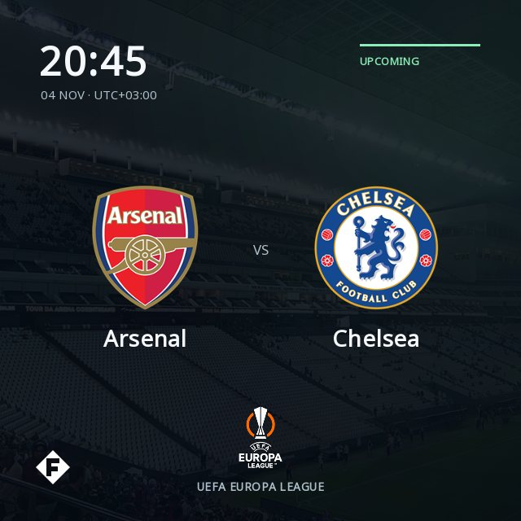
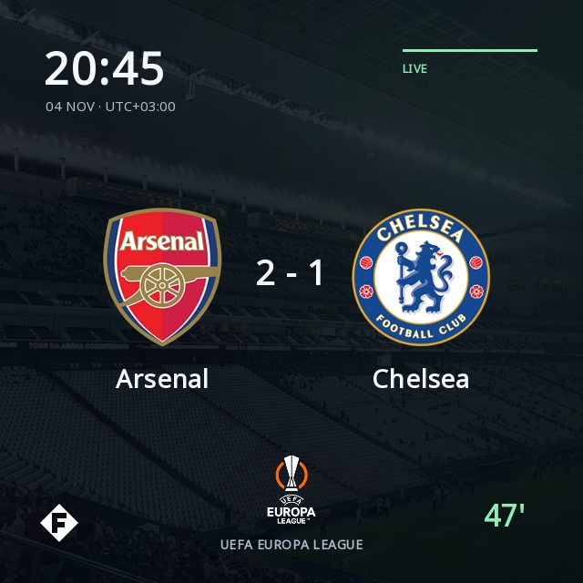
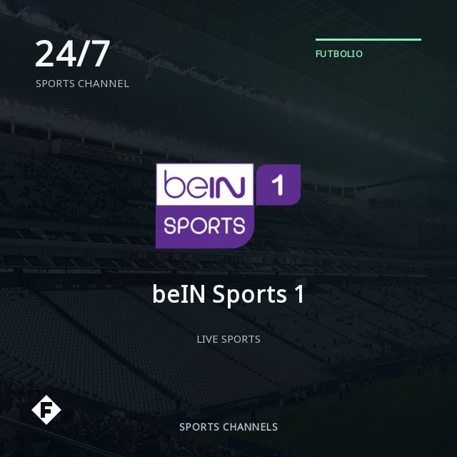

<p align="center">
  
</p>

Futbolio is a companion app for Stremio that adds football matches and sports channels from supported third-party providers. It organizes listings into catalogs and passes available streams to Stremio for playback, with a focus on Turkish football. **You watch in Stremio and keep Futbolio running in the background.** Futbolio does not provide broadcasts or play video itself.

## Download and install

The published release is for **Android / Android TV 8.0 or newer**. Install Futbolio and [Stremio](https://www.stremio.com/downloads) on the **same device**; no computer is needed during playback.

1. Open the [latest release](https://github.com/emrkkya1/futbolio/releases/latest) and expand **Assets** if needed.
2. Download **`futbolio-vX.X.X.apk`**. Choose the APK, not the source-code ZIP or TAR files.
3. Open the APK on your Android device and select **Install**. On a TV, transfer the file to the TV first and open it with a file manager. If Android asks, allow that browser or file manager to **install unknown apps**; you can turn this permission off afterward.
4. Open Futbolio, select **Start Futbolio**, then **How to Install** and **Copy URL**. On TV, open Stremio, go to Add-ons, press **Add Addon**, and paste the URL. On mobile, add the URL through **web.stremio.com** in your mobile browser, signed in to the same account as the Stremio mobile app.
5. In Stremio, browse Futbolio's catalogs, choose a match or channel, and select an available source. **Leave Futbolio running while you watch.**

Futbolio checks this repository's latest stable GitHub release when opened (at most once every 30 minutes while the app process stays alive). A newer compatible release shows a toast and an update prompt. Choose **Download and install** to download the APK and open Android's installer. The first time, Android may ask you to allow Futbolio to **install unknown apps**; installation always needs your confirmation. Your settings are kept.

Use **Settings → Check for updates** to check manually. Release checks require internet access; an offline or failed automatic check does not interrupt the app. The updater verifies the APK's SHA-256 checksum, package, version, and signing key before offering installation. Updates must use the same signing key as your installed app, so local debug builds cannot update to production-signed releases this way. You can also download a newer release APK manually and install it over an existing, compatibly signed installation.

### If the add-on does not install

Check that Stremio is installed and Futbolio is running. Use **Copy URL** under **How to Install** in Futbolio to copy the manifest URL:

```text
http://127.0.0.1:7000/manifest.json
```

This address refers to the Android device itself, not your PC. Opening it on another device will not reach Futbolio on the TV. See **Installation help** in the app for client-specific limitations; web clients may require HTTPS.

## What appears in Stremio

- **Live Now**, **Starting Soon**, **Turkish Football**, **Sports Channels**, and **All Matches** catalogs, plus search and competition filters.
- Match posters with team crests, competition names, and kickoff times. Matching provider listings are grouped into one match with multiple sources.
- Scores and match minutes when a listing can be matched to ESPN data. Confirmed ended matches are hidden; other live-status labels may be kickoff-based estimates.

### Example posters

<p>
  
  
  
</p>

Illustrative fixtures and scores rendered by Futbolio, not current listings or proof of stream availability. Third-party marks belong to their owners; see [artwork notices](engine/src/main/resources/artwork/ARTWORK-NOTICES.md).

## Availability and limits

Futbolio supports PPV, PapazSports, Taraftarium24, FutbolVivo, and 720pstream. Availability depends on those providers, and some sources may only open an external website. Futbolio does not bypass logins, DRM, CAPTCHAs, paywalls, or geographic restrictions. Use only streams you are authorized to access.

Playback depends on the source, Stremio, and your device's codec support. Full-match stability is not guaranteed, and Android may stop the background service under memory pressure. Futbolio sends no analytics, but providers receive requests and can see your public IP.

## Desktop

**Windows and Linux applications are on the roadmap.** Desktop installers are not currently published in releases, but a desktop app can already be built from source. It can serve Stremio on the same computer or trusted devices on a private network. Never expose its port publicly or share its token-bearing URL outside that network.

[Changelog](CHANGELOG.md) · [Score enrichment](docs/SCORE-ENRICHMENT.md)

### Development

For local builds or contributions, see the [development notes](docs/DEVELOPMENT.md), [architecture](docs/ARCHITECTURE.md), [CI and releases](docs/CI.md), and [testing checklist](docs/MANUAL-TESTS.md).
