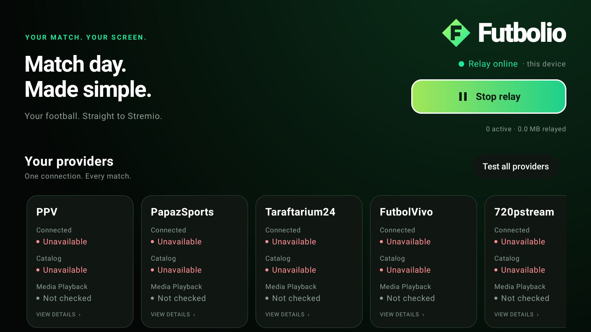

<p align="center">
  
</p>

<p align="center">
  <strong>Your football. Straight to Stremio.</strong><br>
  Live football discovery and HLS relaying, with a Turkish-football focus.
</p>

<p align="center">
  <a href="https://github.com/emrkkya1/futbolio/actions/workflows/check.yml"></a>
  
  
  
</p>

<p align="center">
  <a href="#what-it-does">Features</a> ·
  <a href="#what-it-does-not-do">Limitations</a> ·
  <a href="#getting-started">Get started</a> ·
  <a href="#build-and-test">Build</a> ·
  <a href="#architecture-and-documentation">Documentation</a>
</p>

Futbolio connects supported third-party providers to Stremio. It organizes matches and sports channels into catalogs, resolves available stream links, and relays HLS media through a local server. **Stremio handles video and audio playback; Futbolio is not a video player or a streaming service.**

> [!IMPORTANT]
> **Development build.** Automated tests cover discovery, the Stremio API, and media transport—not guaranteed decoded playback or full-match stability in every client. See the [manual acceptance checklist](docs/MANUAL-TESTS.md).

<p align="center">
  
  <br>
  <sub>Android TV dashboard · Relay running; providers unavailable in this captured session. Playback is not confirmed.</sub>
</p>

## What it does

- Presents Live Now, Starting Soon, Turkish Football, Sports Channels, and All Matches catalogs, plus search.
- Combines matching provider listings into one match with multiple sources; includes competition filters, kickoff times, and locally generated posters.
- Supports PPV, PapazSports, Taraftarium24, FutbolVivo, and 720pstream through configurable adapters.
- Relays HLS playlists, segments, and keys while preserving required headers and supported provider sessions. Media is forwarded incrementally, without saving video files.
- Provides provider diagnostics, configuration import/export, and explicit external-browser options when a playable link cannot be extracted.

## What it does not do

- **Host or supply broadcasts.** Availability and access rights depend on third-party providers; domains and page layouts can change.
- **Bypass access controls.** No DRM, login, CAPTCHA, geographic restriction, or paywall bypass is implemented. Use only streams you are authorized to access.
- **Transcode or repair media.** Codec support and final playback compatibility depend on Stremio and the device.
- **Guarantee live status or match identity.** Unverified statuses are kickoff-based estimates; schedules and duplicate matching can be imperfect. There is no guaranteed EPG or official live-score service.
- **Execute provider JavaScript or run an embedded browser.** JavaScript-only players may offer only a website fallback, which opens outside Stremio's player.
- **Operate as a public relay.** Futbolio is intended for the same device or a trusted private network, not internet-facing deployment.

## Getting started

Build the appropriate app using the commands below, then:

1. Open Futbolio and select **Start Futbolio**.
2. Use **Install in Stremio** / **Install / open Stremio**, or install the displayed manifest URL through a supported Stremio interface.
3. Browse Futbolio's catalogs in Stremio and select a stream. **Keep Futbolio running during playback.**

### Desktop

Runs on the same computer as Stremio, or serves trusted devices on the local network. For another device, stop Futbolio, select your private LAN address under **Network**, save, restart, and install the new URL on that device.

LAN URLs contain a bearer access token: share them only with trusted devices. Do not expose the port publicly or configure router port forwarding. The listener has no TLS or per-user rate limiting. Keep the computer awake; firewall rules, guest Wi-Fi isolation, or a changed LAN address may interrupt access.

Closing the window hides it to the tray where supported; otherwise it exits. **Quit** stops the relay. Packaged desktop distributions include a Java runtime; keep the complete application directory together.

### Android TV

Requires **Android 8.0 / API 26 or newer**. Futbolio and Stremio run on the **same Android device**—no PC is required, and there is no LAN listener. The manifest URL is `http://127.0.0.1:7000/manifest.json`.

The foreground service can continue after the activity closes, but Android may stop it under memory pressure. Add-on installation varies by Stremio version; some TV clients do not accept URL installation or deep links. A PC cannot reach the TV's localhost server, and web clients may require HTTPS.

## Build and test

### Application versioning

`futbolioVersion` in `gradle.properties` is the single application version for the
engine, Stremio manifest, desktop package and Android APK. Android's version code is
derived automatically as `major × 1,000,000 + minor × 1,000 + patch` (e.g. `0.3.1`
→ `3001`). Supported ranges are major `0..2099`, minor/patch `0..999`; `0.0.0`,
prereleases, build suffixes and leading zeros are rejected. Use a higher application
version for every published APK update, including rebuilds. Changes are recorded
in [CHANGELOG.md](CHANGELOG.md); releases use `vX.Y.Z` tags on the reviewed commit
after merging to `main`. Build every platform artifact from that same commit and
preserve the Android signing key so updates retain settings. Debug-signed APKs are
development builds, not production releases. Never commit signing keys or passwords.

### Build commands

Requires **JDK 21**, **Android SDK platform 35 and build tools** for Android tasks, and network access for the first dependency download. Set `JAVA_HOME` and `ANDROID_HOME` as needed. On Windows, use `gradlew.bat` instead of `./gradlew`.

```sh
# Run the desktop app from source
./gradlew :desktop:run

# Build the Android debug APK and a desktop distribution
./gradlew :android:assembleDebug :desktop:createDistributable

# Run deterministic core tests and architecture checks
./gradlew :domain:test :application:test :engine:check
```

- Android debug APK: `android/build/outputs/apk/debug/android-debug.apk`.
- Desktop distribution: `desktop/build/compose/binaries/main/app/`.
- Host tests: `:desktop:test` (requires a graphical session) and `:android:testDebugUnitTest`.
- Live provider tests are separate, opt-in checks; see [live testing](docs/LIVE-PROVIDER-TESTS.md). Successful media retrieval is not proof of Stremio playback.

Native packages must be built on their target OS. Android release builds require signing credentials; debug or development-signed builds are not production releases. Windows build and device-check helpers are in [`scripts/`](scripts/).

## Architecture and documentation

Both apps share one Kotlin/JVM engine. `domain` contains pure matching and catalog policies; `application` owns services and ports; `engine` implements providers, networking, the Stremio API, and relaying. Desktop and Android supply platform lifecycle, persistence, and presentation.

- [Architecture and safety boundaries](docs/ARCHITECTURE.md) · [Restructure progress](docs/RESTRUCTURE-PROGRESS.md)
- [Device and Stremio acceptance checks](docs/MANUAL-TESTS.md) · [Historical verification notes](docs/VERIFICATION.md)
- [Provider research and limitations](docs/STATIC-STREAM-RESEARCH.md)
- [Artwork provenance and redistribution restrictions](engine/src/main/resources/artwork/ARTWORK-NOTICES.md)

## Privacy and third-party assets

Desktop settings are stored in `~/.futbolio/`; `desktop.json` contains the access token and must not be published. Android uses private app storage with backup disabled. Futbolio uploads no analytics or diagnostics, but upstream providers receive requests and can see your public IP.

Third-party logos remain the property of their respective owners. Bundled artwork does not establish redistribution rights or endorsement; review permissions before distributing it.
